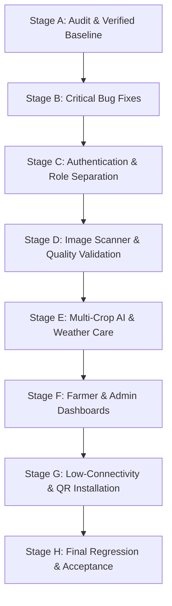

# AgriMind — Comprehensive Implementation & Verification Plan

**Project:** AgriMind Minor Project (`COM71116-21`)  
**Lead Engineer:** Senior Full-Stack, AI/ML, Security, and QA Engineer  
**Objective:** Execute an evidence-based audit, repair verified critical defects, and implement all farmer-centred features in safe, testable stages without destructive modifications to existing working assets.

---

## 1. Principles & Non-Negotiable Constraints

1. **Preserve Authoritative Assets:**
   - ResNet-50 PyTorch checkpoint (`outputs/week2_vision/best_model.pth`, 282.6 MB).
   - ChromaDB persistent vector store (`data/vectorstore/chroma/chroma.sqlite3`, 63 chunks, 882 metadata rows).
   - SQLite case store (`data/cases.db`, 101 cases).
   - PlantVillage dataset splits and test images.
2. **Vision Model Scope Limitation:**
   - Image classification supports exactly three tomato disease classes: `Tomato___Bacterial_spot`, `Tomato___Early_blight`, `Tomato___Late_blight`.
   - All other crops are supported strictly via agricultural Q&A knowledge workflows. Non-crop or irrelevant images must be rejected or clearly flagged.
3. **Language Scope:**
   - English: Full production support.
   - Hindi: Full production support (text, advice, UI, error prompts, TTS).
   - Dogri: Future scope only. No simulated TTS or misleading claims of native support.
4. **Platform Scope:**
   - Android native (Kotlin, Jetpack Compose) first.
   - iOS remains future scope only.
   - Unreliable internet connectivity and offline caching supported.

---

## 2. Staged Implementation Roadmap

### Stage A: Audit & Verified Baseline
- [x] Inspect full codebase across `src/`, `android/`, `tests/`, `data/`, `outputs/`.
- [x] Run Android unit test suite (`49/49 passed`).
- [x] Execute backend test discovery (`218 tests across 23 test files`).
- [ ] Record complete baseline status in `docs/agrimind_verified_baseline.md`.

### Stage B: Critical Bug Fixes
- [ ] **Fix 1: Diagnosis Cache Key Omission (`src/api/routes.py`):**
  - Incorporate `field_notes`, `affected_organs`, `canopy_spread`, `user_query`, and `crop_type` into cache key.
  - Enforce file size and magic-byte validation prior to cache lookup.
  - Add regression test in `tests/test_api.py`.
- [ ] **Fix 2: Test Cache Pollution (`tests/test_feature2_vision_inference.py`):**
  - Add `_IMAGE_SUBMISSION_CACHE.clear()` to `setUp()` and `tearDown()` to ensure test isolation.
- [ ] **Fix 3: Case Outcome Function Signature Mismatch (`tests/test_case_sharing.py`):**
  - Fix test to call `record_outcome(case_id, farmer_id, outcome, details)` matching the production service signature.
- [ ] **Fix 4: Adversarial Chemical RAG Retrieval Gate (`src/rag/retriever.py`, `src/rag/generator.py`):**
  - Implement chemical entity validation and stricter lexical grounding to prevent fabricated terms (e.g. `crypto-solanidine-XYZ99`) from matching unrelated Actigard literature. Return honest insufficient-evidence fallback.

### Stage C: Security, Authentication & Role Separation
- [ ] **Backend User Model & Storage (`src/api/auth.py`, `src/api/routes.py`):**
  - SQLite table `users` (`user_id`, `email`, `password_hash`, `role`, `full_name`, `created_at`).
  - Secure PBKDF2/SHA-256 password hashing with salt.
  - JWT token generation, signature validation, and expiration.
  - Endpoints: `POST /auth/signup`, `POST /auth/login`, `GET /auth/me`.
- [ ] **Role Separation (`farmer` vs `admin`):**
  - FastAPI dependencies `get_current_user`, `require_farmer`, `require_admin`.
  - Admin management endpoints: `GET /admin/users`, `GET /admin/cases`, `GET /admin/system/status`.
  - Private case isolation: enforce that farmers can only view their own cases unless explicitly shared.
- [ ] **Automated Security Tests:**
  - Write `tests/test_auth_and_roles.py` verifying signup, login, password hashing, role protection, and cross-farmer record isolation.

### Stage D: Farmer-Facing Image Scanner Reliability
- [ ] **Image Quality Validation Engine (`src/vision/image_validator.py`):**
  - Blur detection (Laplacian variance threshold).
  - Exposure & brightness check (mean luminance bounds: 35 to 220).
  - Foliar/vegetation ratio check (HSV green mask > 5% leaf coverage to reject non-plant images).
  - Localized English and Hindi guidance messages.
- [ ] **Android Scanner Enhancement (`DiagnosisScreen.kt`):**
  - Dual options: Camera capture (`ActivityResultContracts.TakePicturePreview()`) and Gallery picker (`PickVisualMedia()`).
  - Pre-flight client-side quality checks and clear user correction dialogs.

### Stage E: Multi-Crop Agricultural AI & Weather-Aware Guidance
- [ ] **Multi-Crop Agricultural Knowledge (`src/rag/generator.py`):**
  - Extend agricultural knowledge prompts to support general crops (Wheat, Rice, Potato, Chili, Mustard, Maize, Tomato).
  - Strictly enforce that image-based diagnosis is tomato-only while Q&A covers general agronomy.
  - Fallback honestly when question is outside agricultural domain or lacks evidence.
- [ ] **Weather-Aware Decision Support (`src/services/weather_service.py`):**
  - Actionable advice for heat stress, waterlogging, prolonged leaf wetness, and humidity-driven fungal sporulation.
  - Localized English and Hindi agricultural recommendations.

### Stage F: Dashboards, Settings & Navigation
- [ ] **Farmer & Admin Navigation (`MainActivity.kt`):**
  - Clean Farmer Dashboard layout: Crop Scanner, AI Assistant, Weather, History, Community, Reports, Settings.
  - Role-protected Admin Dashboard showing system status, telemetry, user count, and case moderation.
  - Account and settings screen: profile details, language toggle (English/Hindi), logout, privacy controls.

### Stage G: Low-Connectivity Behavior & QR Installation
- [ ] **Offline Resilience:**
  - Room SQLite caching for cases, reports, and pending actions.
  - Offline sync status indicator.
  - Clear disclosure when network is required for live inference.
- [ ] **QR-Code Installation Workflow:**
  - Generate verifiable QR code pointing to the real built APK (`android/app/build/outputs/apk/debug/app-debug.apk`).
  - Document manual installation instructions and security settings on Android.

### Stage H: Regression & Final Release Audit
- [ ] Execute full backend test suite and Android unit tests.
- [ ] Verify debug APK compilation.
- [ ] Produce final deliverables: `docs/agrimind_change_log.md`, `docs/agrimind_test_evidence.md`, and `docs/agrimind_release_readiness.md`.

